<p align="center">
  <a href="https://www.bobebot.com">
    <picture>
      <source media="(prefers-color-scheme: dark)" srcset="docs/media/banner-dark.png">
      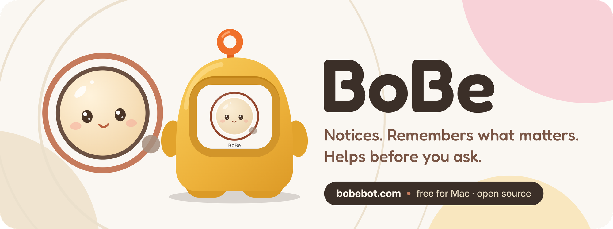
    </picture>
  </a>
</p>

<p align="center">
  <a href="https://www.bobebot.com"><b>Website</b></a>
  &nbsp;·&nbsp;
  <a href="https://github.com/Sombrace/BoBe/releases/latest"><b>Download</b></a>
  &nbsp;·&nbsp;
  <a href="#quick-start"><b>Quick start</b></a>
  &nbsp;·&nbsp;
  <a href="docs/README.md"><b>Guides</b></a>
  &nbsp;·&nbsp;
  <a href="docs/architecture.md"><b>Architecture</b></a>
  &nbsp;·&nbsp;
  <a href="CONTRIBUTING.md"><b>Contributing</b></a>
</p>

<p align="center">
  <a href="https://github.com/Sombrace/BoBe/releases/latest"></a>
  <a href="LICENSE"></a>
  
  
</p>

<p align="center">
  <a href="https://www.bobebot.com">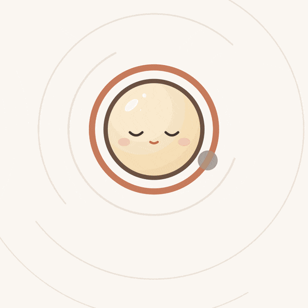</a>
</p>

<p align="center"><sub>BoBe's film, without its sound. The yellow body is a prototype.</sub></p>

## Meet BoBe

BoBe is a companion who lives on your Mac. She sits on your desktop as a small
face, notices what you are working on, remembers what matters to you, keeps
track of your goals, and speaks up when she thinks she can help. You can type
to her or talk to her, and she can do real work with files, a shell, Git and
your own tools.

She is yours. One BoBe, one memory, one set of goals, kept on your own machine.
You choose where her thinking runs: OpenAI, Anthropic, DeepSeek, OpenRouter,
Rail Relay, GitHub Copilot, or a model on your own computer through Ollama or
any OpenAI-compatible endpoint. Only the context a cloud answer needs leaves
your machine.

## See her at work

<table>
  <tr>
    <td width="72%" valign="middle">
      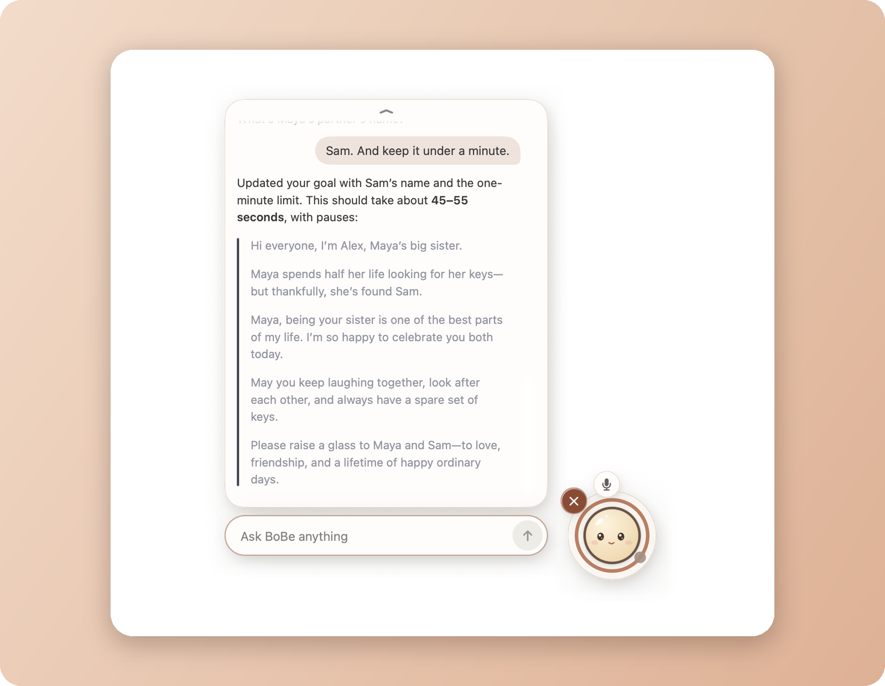
    </td>
    <td valign="middle" align="center">
      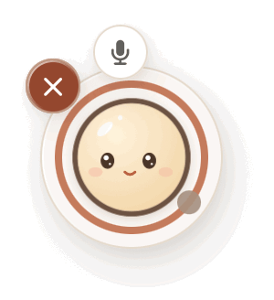
      <br>
      <sub>Thinking</sub>
    </td>
  </tr>
</table>

<p align="center"><sub>Click her face to open the conversation; click anywhere else and she folds away.</sub></p>

## What BoBe does

<table>
  <tr>
    <td width="33%" valign="top">
      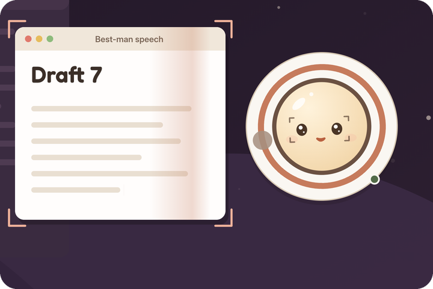
      <h3>Notices your work</h3>
      Reads the text on your screen every couple of minutes, on your Mac. The picture never leaves it; only the words go to your model. Screen awareness is optional.
    </td>
    <td width="33%" valign="top">
      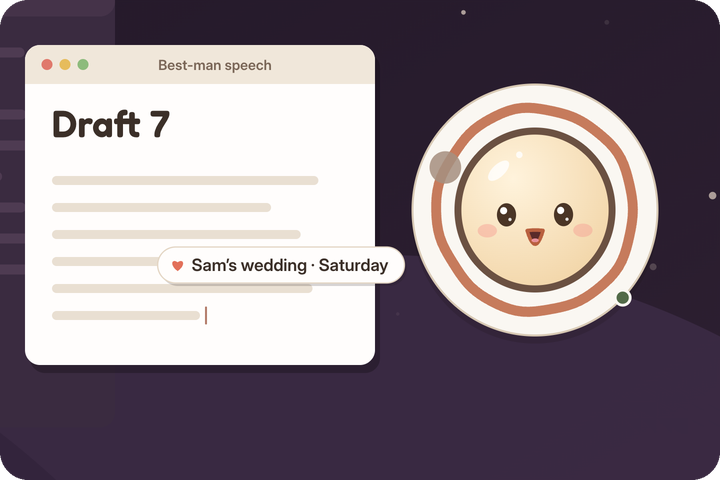
      <h3>Remembers you</h3>
      Keeps one memory document on your machine and adds lasting facts as she learns them. You can read and edit all of it.
    </td>
    <td width="33%" valign="top">
      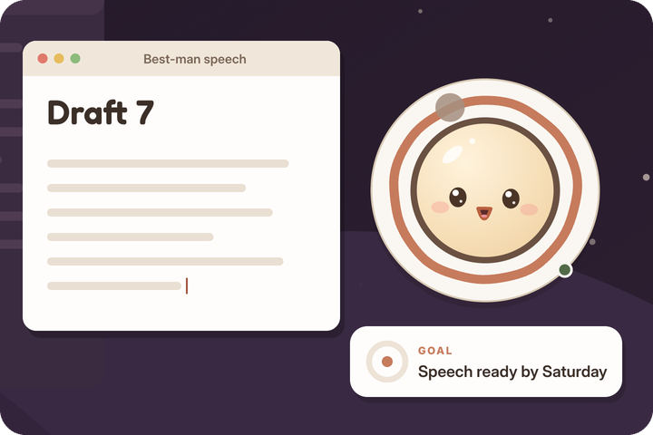
      <h3>Works on your goals</h3>
      Goals are plain Markdown. She reviews active ones every hour, makes quiet progress, and gives every goal an ending.
    </td>
  </tr>
  <tr>
    <td width="33%" valign="top">
      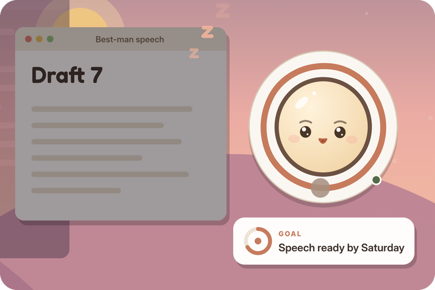
      <h3>Respects your flow</h3>
      Quiet, Balanced or Proactive. Cooldowns and turn rules stop her from talking over you or interrupting too often.
    </td>
    <td width="33%" valign="top">
      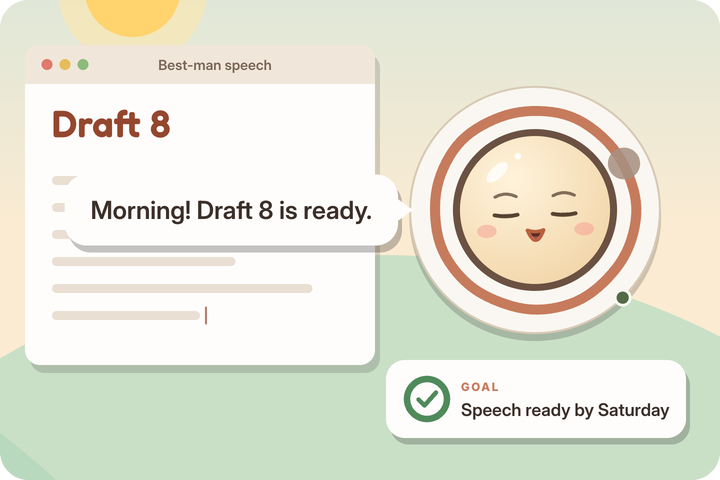
      <h3>Speaks first</h3>
      Check-ins, goal results and things she noticed arrive as small bubbles with one-tap replies. Missed ones wait for you.
    </td>
    <td width="33%" valign="top">
      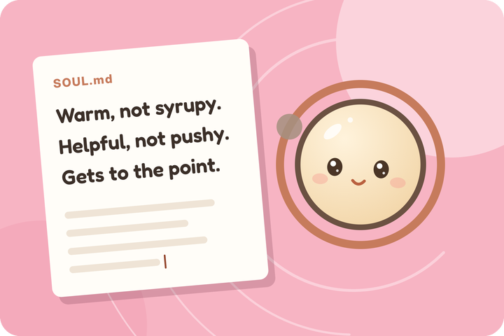
      <h3>Has a personality</h3>
      Soul documents shape how she talks. Write your own or keep the default.
    </td>
  </tr>
</table>

**Talks and listens.** Speak to her and she answers out loud. Talk over her to
interrupt; a quick "mm-hmm" will not stop her, and she knows which part of her
answer you actually heard.

**Uses tools.** Files, search, shell, Git, MCP servers, skills, parallel calls
and delegated agents, all working in one folder you can open.

**Keeps going.** She can carry a task on after replying, come back to it on a
schedule, and save an important question for you instead of guessing.

## Talk to her

<table>
  <tr>
    <td width="58%" valign="top">
      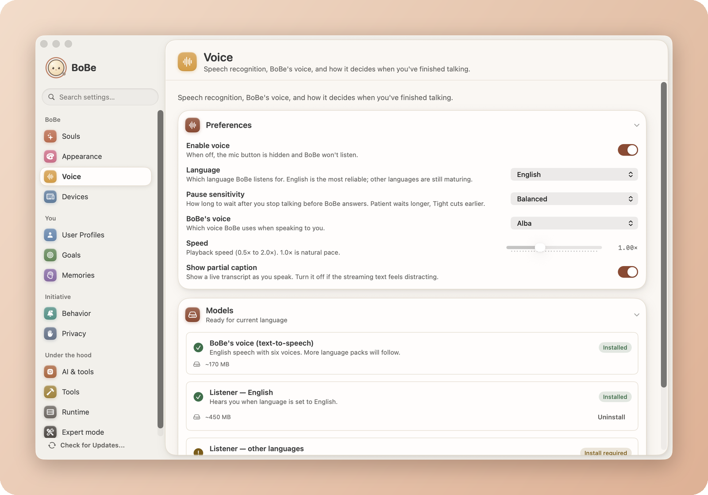
    </td>
    <td valign="top">
      <p>Speech recognition and BoBe's voice run on your own hardware, not on a cloud speech service. Raw audio is not stored.</p>
      <ul>
        <li>Pick her voice, speed and how long she waits for you to finish.</li>
        <li>Trail off on "and…" and she waits for the rest.</li>
        <li>English speech models are about 600 MB, downloaded once.</li>
        <li>English is the most reliable; other languages are still maturing.</li>
      </ul>
      <p><a href="docs/using-bobe.md#talking-to-bobe">More about voice</a></p>
    </td>
  </tr>
</table>

## Make her yours

<p align="center">
  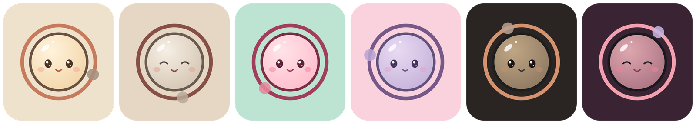
</p>

<p align="center">
  <sub>Terracotta Dreams &nbsp;·&nbsp; Soft Clay &nbsp;·&nbsp; Bubblegum &nbsp;·&nbsp; Cotton Candy &nbsp;·&nbsp; Midnight Clay &nbsp;·&nbsp; Twilight Rose</sub>
</p>

Six themes, light and dark, or follow the system. Everything else about her is
in Settings too: who she is, what she knows about you, and how present she is.

<table>
  <tr>
    <td width="33%" valign="top">
      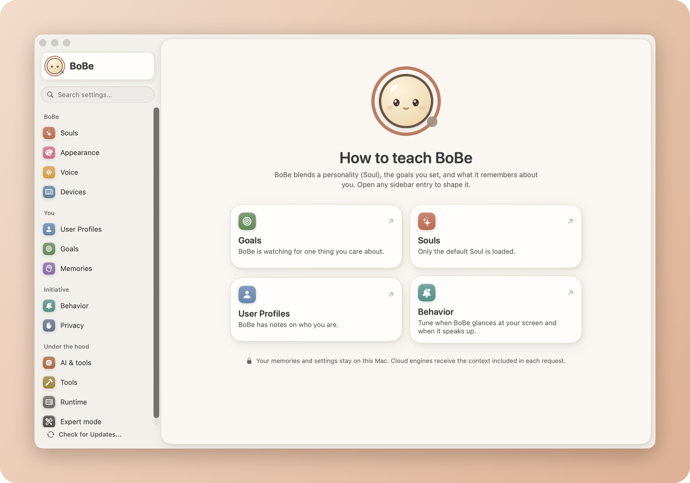
      <p align="center"><sub>Teach her: goals, souls, profiles, memories</sub></p>
    </td>
    <td width="33%" valign="top">
      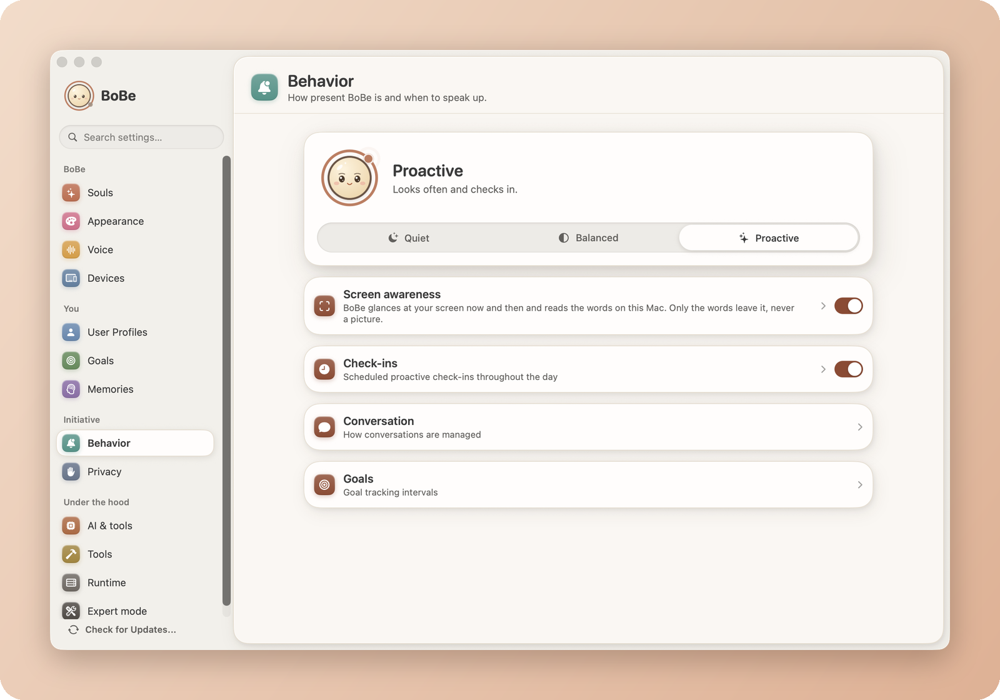
      <p align="center"><sub>Choose how present she is</sub></p>
    </td>
    <td width="33%" valign="top">
      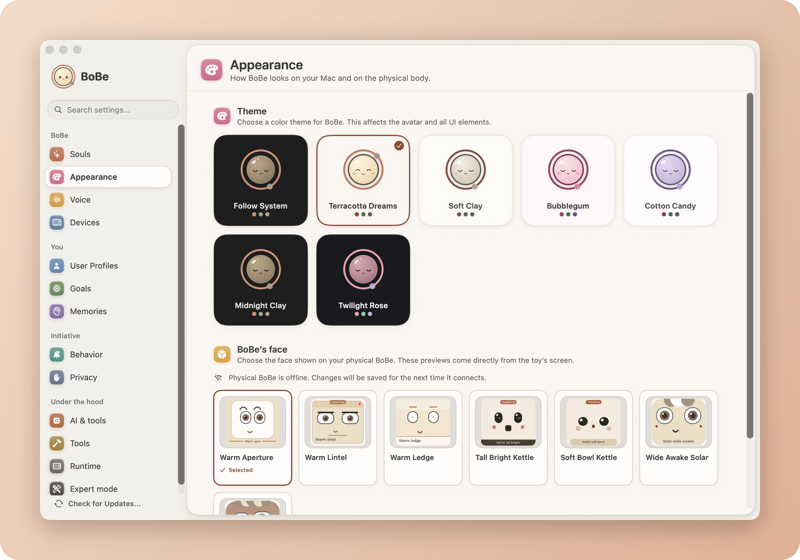
      <p align="center"><sub>Themes, and faces for the physical body</sub></p>
    </td>
  </tr>
</table>

## A body, in the lab

<table>
  <tr>
    <td width="42%" valign="top">
      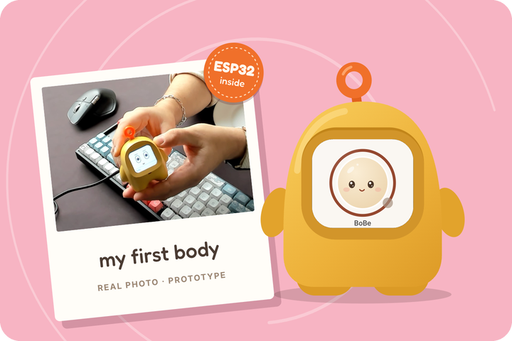
    </td>
    <td valign="top">
      <p>BoBe does not have to live only on a screen. The small yellow body in the film is real hardware: an ESP32 toy that shows her face and talks to the same companion. One BoBe, one memory, more than one place to meet her. It is a prototype, not a production toy for sale.</p>
      <p>Build an ESP32 surface with the <a href="esp32-sdk/README.md">BoBe ESP32 SDK</a> in this repository: a voice body, text display, keyboard, button, or sensor. The WB-12 is its full voice example.</p>
      <p>The <a href="docs/iphone.md">iPhone app</a> is another surface of the same companion.</p>
      <p><a href="docs/physical-bobe.md">Physical BoBe</a></p>
    </td>
  </tr>
</table>

## Quick start

These guides describe this source revision. For a downloaded build, check its
release notes for platform and feature availability.

### What you need

| | |
|---|---|
| **A Mac** | Apple Silicon, macOS 26 or later |
| **A model** | One of: an API key (OpenAI, Anthropic, DeepSeek, OpenRouter), a Rail Relay token, a supported provider sign-in (OpenAI, GitHub Copilot), or [Ollama](https://ollama.com) on your own machine |
| **Disk space** | About 600 MB for the English speech models; more for other languages and local models |
| **Permissions** | Microphone for voice. Screen Recording only if you turn on screen awareness |

To build from source you also need Xcode 26 or later and
[rustup](https://rustup.rs). Rust 1.98.1 is selected for you by
`rust-toolchain.toml`. No Apple developer account is needed.

### Install the app

Download the latest `BoBe.dmg` from the
[Releases](https://github.com/Sombrace/BoBe/releases) page, drag BoBe to
Applications, and open it.

### Or build from source

```bash
git clone https://github.com/Sombrace/BoBe.git
cd BoBe
scripts/tasks/bootstrap-tools.sh
scripts/tasks/run.sh
```

The first build downloads pinned tools, Node and dependencies into the
checkout. Nothing is installed globally. The app is built unsigned unless you
[give it your Apple team](docs/getting-started.md#signed-or-unsigned).

### First launch

Setup takes a few minutes and walks you through:

1. **Where BoBe runs**: on this Mac, or on another machine you connect to
2. **Her model**: a provider, a custom endpoint, or local Ollama
3. **You**: your name, and a first goal if you like
4. **How present she is**: Quiet, Balanced or Proactive
5. **Permissions**: screen awareness is optional
6. **Voice**: install the speech models

Then BoBe appears on your desktop, with an icon in the menu bar. Quit from that
menu and the daemon the app started stops with her.

**Next:** [Getting started](docs/getting-started.md) ·
[Using BoBe](docs/using-bobe.md) · [Troubleshooting](docs/troubleshooting.md)

## Without the app

The same BoBe runs headless on a Mac or a Linux machine and is driven from the
`bobe` command line:

```bash
bobe setup
bobe chat
```

Setup guides you through the service, provider and model, your name, optional
network access and device pairing. Individual commands remain available.

The [command line guide](docs/cli.md) covers providers, Ollama, background
work, schedules, memory, skills, remote access, backup and updates.

## Models

| Inference provider | Description |
|---|---|
| **OpenAI** | API key, or the provider's own sign-in. Account access and billing are separate. |
| **Anthropic** | API key. Claude subscription login is not offered in BoBe. |
| **DeepSeek / OpenRouter** | Your provider API key and chosen model. |
| **Rail Relay** | An external inference endpoint with a token you paste in. |
| **GitHub Copilot** | Optional, with your supported GitHub sign-in. |
| **[Ollama](https://ollama.com) / compatible endpoints** | Local or custom OpenAI-compatible inference. BoBe can install Ollama and the models you select on her host. |

Changing provider changes where the thinking runs, not who BoBe is. Her
conversations, memory, goals and abilities stay the same across restarts and
provider changes. You can give different work to different models: one for
conversation, one for goal work, a small one for quick decisions and
summaries.

Cloud providers charge for what BoBe uses, including her hourly goal reviews
and check-ins. A goal's reviews rest after three in a row that change nothing,
and **Settings → Behavior** controls screen awareness, check-ins and how often
goals are reviewed.

## Supported platforms

| Platform | Architecture | Minimum version | Status |
|----------|-------------|-----------------|--------|
| macOS app and daemon | Apple Silicon (arm64) | macOS 26 | ✅ Supported |
| Ubuntu daemon | x86_64 | — | Build from source; standalone CLI and guided setup |
| iPhone surface | iPhone | iOS 26 | Source app; requires a reachable BoBe runtime. See [capabilities and limits](docs/iphone.md) |

The interface is available in English, Greek, Chinese, German, Spanish,
Portuguese, Korean, Japanese and French.

## Your data

Everything BoBe knows lives under `~/.bobe/` on the machine that runs her
daemon: conversations, memory, goals, skills, her workspace, provider
credentials and backups. Memory and goals are plain Markdown files you can
open and edit. **Settings → Privacy** shows where each kind of work is sent and
can delete her conversations, memory, goals and work. Set `BOBE_DATA_DIR` to
keep the data somewhere else.

## Privacy and security

BoBe handles sensitive data: what is on your screen, personal context, and
provider credentials. See [SECURITY.md](SECURITY.md) for how to report a
vulnerability.

- **Local by default.** The daemon listens on `127.0.0.1` unless you deliberately configure remote access.
- **Screens stay on the Mac.** Screen awareness reads text on the device and discards the picture. No image is sent to any model.
- **No stored audio.** Speech is recognised and synthesised on your own hardware; raw audio is not stored.
- **Secrets in private files.** Provider credentials are `0600` files under the daemon's data root. The signed app keeps only its own endpoint credential, in the Keychain; an unsigned build from source keeps it in memory and never writes it down.
- **Honest about tools.** File and shell tools run as your user account from BoBe's workspace. This is a single-owner boundary, not an operating-system sandbox.
- **MCP commands** are checked against a configurable blocklist.
- **Remote access is explicit.** `bobe config remote` turns it on with TLS the daemon creates and renews itself; `bobe device pair` shows a six-digit code for each Mac, and each Mac gets its own revocable credential. No certificates, shared tokens or reverse proxy to set up.

## Documentation

**Guides**

| Guide | What it covers |
|---|---|
| [Getting started](docs/getting-started.md) | What you need, installing, building from source, first launch |
| [Using BoBe](docs/using-bobe.md) | The overlay, voice, goals, memory, souls, initiative, tools and privacy |
| [Command line](docs/cli.md) | Running BoBe headless, providers, background work, remote access, backup |
| [iPhone](docs/iphone.md) | Pairing, conversation, goals, memory and current phone limitations |
| [Troubleshooting](docs/troubleshooting.md) | Start-up, provider, voice and permission problems |

**Reference**

| Document | What it covers |
|---|---|
| [Product contract](PRODUCT.md) | What BoBe is, and the product shapes it rejects |
| [Architecture](docs/architecture.md) | How the Rust daemon, the pi worker and the Swift app are built |
| [Physical BoBe](docs/physical-bobe.md) | Voice, embodiment, and room devices |
| [ESP32 SDK](esp32-sdk/README.md) | Building a body or another small surface |
| [Device pairing](docs/device-pairing-crypto.md) | How a Mac and a daemon come to trust each other |
| [Updates](docs/cli.md#updating) | App updates and signed standalone update files |
| [Releasing](docs/releasing.md) | How maintainers build, sign, notarize and publish a release |
| [Contributing](CONTRIBUTING.md) | Setup, conventions, and project structure |

## Contributing

Contributions are welcome. [CONTRIBUTING.md](CONTRIBUTING.md) has the
development setup, the checks to run, and how changes are reviewed. Bugs and
ideas go to [Issues](https://github.com/Sombrace/BoBe/issues); security reports
go through [SECURITY.md](SECURITY.md).

This project follows the [Contributor Covenant Code of Conduct](CODE_OF_CONDUCT.md).

## License

The source code is under the [MIT License](LICENSE). The BoBe name, logo, character
and promotional media are not; see [Trademarks](TRADEMARKS.md).

Downloaded speech models have their own licenses and attribution; see
[Speech](docs/speech.md#models-and-licenses). Released apps include the licenses of
the open-source software they contain.

<p align="center">
  <br>
  <a href="https://www.bobebot.com"></a>
  <br>
  <sub><a href="https://www.bobebot.com">bobebot.com</a></sub>
</p>
