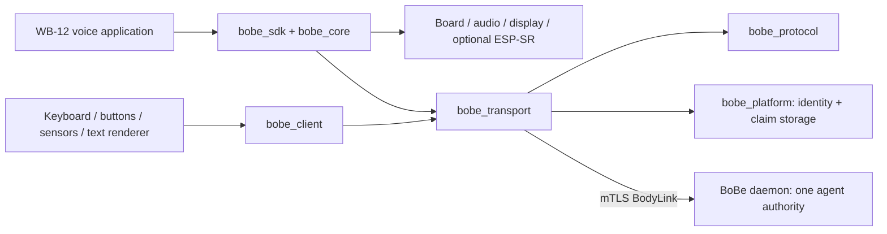

# Architecture and ecosystem choices

## Name and conventions

The **BoBe ESP32 SDK** lives in `esp32-sdk/` in the BoBe repository.
Component names use underscores; public device-client APIs use the `esp_bobe_` prefix.
The SDK has its own CMake entry point, Python tooling and board examples.
The daemon, Mac app and SDK share source revisions, not execution lifecycles.

The implementation follows ESP-IDF's component/CMake/Kconfig workflow:

- [ESP-BSP](https://github.com/espressif/esp-bsp/blob/master/docu/how_to_use.md)
  separates board wiring from consistent peripheral APIs and capabilities.
- [Component Manager](https://docs.espressif.com/projects/idf-component-manager/en/latest/reference/manifest_file.html)
  supports local and Git dependencies, including sibling components pinned to the
  same revision. The SDK uses those mechanisms instead of a custom package system.
- [esp_codec_dev](https://github.com/espressif/esp-adf/tree/master/components/esp_codec_dev)
  illustrates a reusable device interface. WB-12 tracks DMA completion
  because a generic codec write return is not proof of speaker drain.

## Boundaries

`bobe_protocol` is portable C11 with C++ linkage: wire types, media framing, JSON
bounds, capabilities, interactions, and signed OTA envelope parsing. It has no
ESP-IDF, NVS, board header, or display configuration dependency. OTA model and
image-size validation are supplied by the caller.

`bobe_text` is a caller-buffer text assembler with no allocation or GUI dependency.
It preserves UTF-8 boundaries when discarding old text to fit a small display.

`bobe_platform` owns ESP-IDF identity and claim-storage conventions. Both runtime
paths and provisioning share the persistent identity and preserve factory and
existing BoBe IDs. NVS initialization failure stops startup without formatting
storage. An incompatible or damaged partition requires explicit recovery.

`bobe_transport` owns one authenticated connection per MCU: framing, epoch checks,
reconnect generations, heartbeat replies, bounded queues, and playback routing. Control messages
allocate their actual size. Non-audio devices avoid the large microphone queue;
buffers can use internal memory when PSRAM is absent. The lightweight client
retains bounded resources for the firmware lifetime and supports stop/start.

`bobe_client` exposes typed callbacks and send functions. Applications own their
network, clock, peripherals, and renderer. The voice runtime composes the same
transport with deterministic device policy and hardware drivers.

The WB-12 example owns its pins, calibration, display setup, partition layout,
and public update key. Its local microphone indicator and DMA-based playback
accounting are part of the hardware implementation.

## Authority and failure behavior

Devices submit user intent or observations. They do not host another agent.
Text/actions use BoBe's shared request service and conversation admission.
Request IDs are scoped to the authenticated endpoint. Completed requests can
be replayed without repeating model/tool execution; interrupted requests require
an explicit new user decision.

Owner enrollment grants are separate from observed capabilities. A minor-1
voice enrollment with empty grants allows voice. Explicit grants apply at
either minor; minor-2 input/output grants are always required.

Telemetry stays in daemon memory within the
[BodyLink sensor limits](bodylink-v1.2.md#sensors). Revocation or privacy purge
clears it. Samples do not start a model call.

Output is endpoint-specific and bounded by the advertised frame limit. Slow
consumers cancel model work rather than grow an unbounded queue. Applications
render received text as data and never execute it as code.
