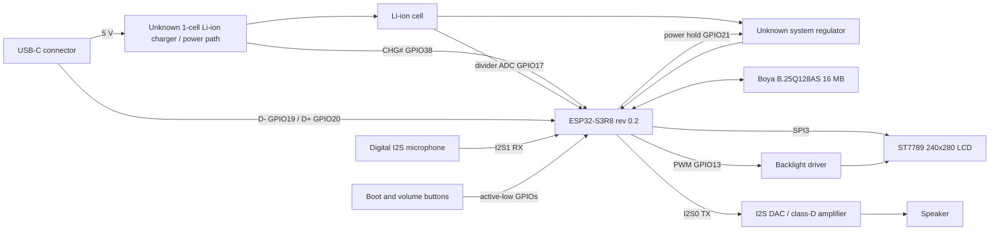

# WB-12 example for the BoBe ESP32 SDK

This is the complete WonderBoy WB-12 application and its hardware validation
tooling. Run the commands below from this directory. Shared firmware lives in
[`../../components`](../../components); the board port is in
[`components/bobe_board_port`](components/bobe_board_port). See the
[SDK README](../../README.md) for reusable components and new-board integration.

# WonderBoy WB-12 AI Buddy: hardware and firmware findings

## Scope and evidence

This document covers the exact Xiamen WonderBoy/顽豹 **WB-12 AI Buddy**.
It is not a Spotpear Muma board or a generic Xiaozhi reference design.

The logical schematic and pin map below were recovered from the factory
application itself and cross-checked against ESP-IDF data structures and the
matching Xiaozhi audio/button implementations. No exact public schematic,
board source, firmware download, PCB photo, teardown, BOM, battery
specification, manual, or service document has been published.

Research date: 2026-07-15/16 (UTC+8).

Evidence labels:

- **Exact**: observed from the physical device, factory firmware, official
  legal/store records, or authoritative component mappings.
- **High confidence**: multiple independent sources agree, but the physical
  part marking was not visible.
- **Unresolved**: requires opening the enclosure and reading the PCB or IC.

## BoBe body firmware

This example contains a clean-room ESP-IDF project that turns the WB-12 into an
expressive physical body for BoBe. Explicit flashing replaces an application
slot. Signed A/B OTA and application rollback remain supported. Restoring the
factory firmware of a particular device is not part of this example.

- System architecture: [`docs/architecture.md`](docs/architecture.md)
- BodyLink protocol: [`docs/bodylink-v1.md`](docs/bodylink-v1.md)
- Autonomous validation stack:
  [`hil/README.md`](hil/README.md) and
  [`docs/hil-toolchain.md`](docs/hil-toolchain.md)
- Firmware source: [`main/`](main/) and [`components/`](components/)
- Exact dependencies: [`bobe_sdk/idf_component.yml`](../../components/bobe_sdk/idf_component.yml) and
  [`dependencies.lock`](dependencies.lock)

Build and test without flashing:

```bash
tools/bootstrap_idf.sh
tools/check.sh
```

`tools/check.sh` does not invoke `flash`, `app-flash`, `erase-flash`, or any
eFuse operation. [`tools/README.md`](tools/README.md) describes what it checks.

## Executive summary

| Area | Finding |
|---|---|
| Product | AI机器人（WB-12） / 顽豹 AI Buddy |
| Manufacturer | 厦门顽豹创新设计有限公司 |
| Factory board name | `WonderBoy-AI-Buddy` / class `WonderBoy_Ai_Buddy` |
| MCU | ESP32-S3 QFN56 rev 0.2, effectively ESP32-S3R8 |
| CPU/radio | Dual core + LP core, 240 MHz, 2.4 GHz Wi-Fi, Bluetooth 5 LE |
| RAM | 8 MB in-package AP Memory 3.3 V octal PSRAM |
| Flash | 16 MB Boya/BoHong `B.25Q128AS`, JEDEC `68:4018` |
| Display | ST7789, 240 x 280 active pixels, SPI |
| Audio | Separate direct-I2S digital microphone and I2S DAC/amplifier |
| Battery | Single-cell Li-ion architecture, ADC divider and active-low charge status |
| USB | Native ESP32-S3 USB Serial/JTAG over USB-C |
| Firmware | Private Xiaozhi fork, app `2.0.9`, ESP-IDF `5.5` |
| Provisioning | Open `Xiaozhi-xxxx` Wi-Fi captive portal; BluFi exists in a public developer port, not the sampled factory image |
| Programming | Secure Boot off, flash encryption off, ROM download available |

## Product identity and provenance

The official Taobao listing is item
[`1038989685719`](https://world.taobao.com/item/1038989685719.htm), sold by
**顽豹旗舰店** for ¥199 from Xiamen under the title:

> 顽豹AI Buddy人工语音智能ai小机器人桌面带时钟儿童学习玩具豆包

The matching export listing is AliExpress item
[`1005012235966917`](https://www.aliexpress.com/item/1005012235966917.html).
Its packaging says **AI Buddy SMART VOICE ASSISTANT** and markets
DeepSeek + 豆包 capabilities.

Chinese design patent
[`CN309963584S`](https://patents.google.com/patent/CN309963584S/zh),
application `202530462616.X`, is exactly titled **AI机器人（WB-12）**.
It was filed 2025-08-06 and granted 2026-05-05 to
厦门顽豹创新设计有限公司. The patent protects the enclosure shape, not the
electronics.

Company records:

| Field | Value |
|---|---|
| Legal name | 厦门顽豹创新设计有限公司 |
| Unified social credit code | `91350206MADRHP3L7N` |
| Legal representative | 刘遇丰 |
| Established | 2024-07-23 |
| Registered capital | RMB 500,000 |
| Registered address | 厦门市湖里区护安路652号凌云玉石大厦413室 |
| Patent correspondence address | 厦门市湖里区岐山北路770号608室 |

The official 1688 factory profile advertises ODM/OEM work, SMT, solder-paste
printing, through-hole assembly, manual soldering, rework, functional testing,
and aging tests. Those production figures are marketplace self-reporting, not
an audited manufacturing report.

## Logical hardware architecture



The charger, regulator, microphone, amplifier, speaker, battery, and LCD glass
part numbers are not software-addressable. Their exact markings require a
physical teardown.

## Complete recovered GPIO map

| GPIO | Direction | Function | Electrical/protocol detail |
|---:|---|---|---|
| 0 | Input | Boot/action/power button | Active-low, internal pull-up; ROM strap pin |
| 4 | Output | Microphone WS/LRCLK | I2S1 RX clock, master |
| 5 | Output | Microphone BCLK/SCK | I2S1 RX clock, master |
| 6 | Input | Microphone data | I2S1 RX serial data |
| 7 | Output | Speaker data | I2S0 TX serial data |
| 8 | Output | LCD D/C | ST7789 command/data select |
| 9 | Output | LCD SCLK | SPI3 clock |
| 10 | Output | LCD MOSI | SPI3 display data; no MISO |
| 13 | Output | LCD backlight | Non-inverted 25 kHz PWM |
| 14 | Output | LCD CS | ST7789 chip-select |
| 15 | Output | Speaker BCLK | I2S0 TX clock, master |
| 16 | Output | Speaker WS/LRCLK | I2S0 TX clock, master |
| 17 | Analog input | Battery voltage | ADC2 channel 6, divider input |
| 18 | Output | LCD reset | ST7789 hardware reset |
| 19 | USB | USB D- | Fixed ESP32-S3 native USB pin |
| 20 | USB | USB D+ | Fixed ESP32-S3 native USB pin |
| 21 | Output | System power hold | Active-high; low requests shutdown |
| 38 | Input | Charger status | Active-low `CHG#` |
| 39 | Input | Volume-down button | Active-low, internal pull-up |
| 40 | Input | Volume-up button | Active-low, internal pull-up |

No board-specific use was recovered for the remaining general-purpose GPIOs.
External flash and in-package PSRAM use the ESP32-S3 memory interface rather
than the application pin map above.

## Display subsystem

The factory board calls the ESP-IDF ST7789 driver directly.

| Property | Recovered value |
|---|---|
| Controller | Sitronix ST7789 family |
| Active pixels | 240 x 280 |
| Firmware construction | width 280, height 240, then swap X/Y |
| Pixel format | RGB, 16 bits per pixel |
| Host | SPI3 |
| SPI mode | Mode 3 |
| Pixel/SPI clock | 80 MHz |
| Transfer | DMA auto, write-only |
| CS | GPIO14 |
| D/C | GPIO8 |
| Reset | GPIO18 |
| SCLK | GPIO9 |
| MOSI | GPIO10 |
| Backlight | GPIO13, 25 kHz PWM, non-inverted |
| Geometry | X offset 20, Y offset 0, mirror X, not mirror Y, invert color |

The physical diagonal is not encoded. A 240 x 280 ST7789 panel is commonly
sold as 1.69 inches, but that diagonal remains an inference until the LCD
module is measured.

### Touchscreen status

The factory application has no CST, FT, GT, AXS, or `esp_lcd_touch` driver,
no touch I2C/SPI bus, and no board touch-event path. This WB-12 firmware treats
the display as non-touch. A marketing image showing a finger on the screen is
not evidence of a touch controller.

## Audio subsystem

The board uses the Xiaozhi `NoAudioCodecSimplex` path: there is no shared
codec control bus and no MCLK. It uses two independent I2S controllers.

### Speaker path

| Property | Value |
|---|---|
| I2S controller | I2S0 TX |
| Sample rate | 24 kHz |
| Slot | Mono, left |
| Data width | 16 bits |
| Slot width | 32 bits |
| BCLK | GPIO15 |
| WS/LRCLK | GPIO16 |
| Data out | GPIO7 |

The data must feed a fixed-configuration I2S DAC/class-D amplifier, likely a
MAX98357-compatible class of device, followed by the speaker. The exact IC and
speaker impedance are unresolved.

### Microphone path

| Property | Value |
|---|---|
| I2S controller | I2S1 RX |
| Sample rate | 16 kHz |
| Slot | Mono, left |
| Slot width | 32 bits |
| BCLK/SCK | GPIO5 |
| WS/LRCLK | GPIO4 |
| Data in | GPIO6 |

This is a digital I2S MEMS microphone class interface. No part identity is
available over I2S; the package marking is required to distinguish parts such
as INMP441-, ICS-43434-, or MSM261S4030-class microphones.

## Buttons and user controls

The three application-visible buttons are configured active-low with internal
pull-ups, so their normal physical wiring is a switch from the GPIO to ground.
Physical inspection also confirms a fourth rear button wired as hardware
reset/EN; it resets the MCU directly and does not produce an application button
event.

| GPIO | Factory behavior |
|---:|---|
| 0 | Single click enters Wi-Fi setup during startup or toggles chat afterward; long press shuts down/deep-sleeps |
| 40 | Volume up; long press selects the high/max-volume action |
| 39 | Volume down; long press mutes |

GPIO0 also remains the ESP32-S3 ROM download strap. Native USB auto-reset can
enter the ROM loader without relying on a separately exposed reset button.
BoBe uses GPIO0 as hold-to-talk while online. Holding volume-down and GPIO0
together requests an intentional software shutdown; holding GPIO0 alone must
never interrupt an active voice turn. Holding both volume buttons opens secure
provisioning recovery.

## Power and battery subsystem

The firmware confirms a single-cell Li-ion power architecture but not the
analog component models.

| Signal | Recovered behavior |
|---|---|
| Power hold | GPIO21 is initialized as RTC output and driven high |
| Shutdown | Firmware drives GPIO21 low, holds it, turns the display off, and enters deep sleep |
| Charge status | GPIO38, active-low |
| Battery sense | GPIO17 / ADC2 channel 6 |
| ADC mode | 12-bit, 12 dB attenuation |
| Power-save timers | 300 seconds to low-power behavior, 600 seconds to shutdown behavior |
| Low-voltage shutdown | Approximately 3.4 V |

Factory battery lookup table:

| Raw ADC | Displayed level |
|---:|---:|
| 1970 | 0% |
| 2062 | 20% |
| 2154 | 40% |
| 2246 | 60% |
| 2338 | 80% |
| 2430 | 100% |

The range is consistent with an approximately 2:1 battery divider, but the
resistor values are not recoverable from software.

Unresolved physical power components:

| Component | Why unresolved |
|---|---|
| Charger/power-path IC | Only an active-low status output reaches the ESP |
| 3.3 V regulator/load switch | No digital control or identity interface |
| Divider resistors | Firmware exposes only the ADC calibration table |
| Battery | No gauge or one-wire identification; capacity and cell model are absent |

## MCU, memory, and flash

### ESP32-S3

- QFN56 package, silicon revision v0.2.
- Dual Xtensa LX7 application cores plus LP core, up to 240 MHz.
- 40 MHz crystal.
- 2.4 GHz Wi-Fi and Bluetooth 5 Low Energy.
- The sampled factory boot did not initialize a Bluetooth stack, and its
  application contains no BluFi symbols.
- 8 MB in-package generation-3 octal PSRAM from AP Memory, 3.3 V.
- PSRAM device ID `0x02`, 64 Mbit, good-die pass, fixed latency, 10-cycle
  reads, 32-byte hybrid-wrap bursts, 1/1 drive strength, and 80 MHz operation.
- PSRAM timing tuning selected index 4 at boot.
- Device is effectively the ESP32-S3R8 package variant.

### External flash

ROM probing returned JEDEC manufacturer/device `68:4018`. Flashrom's JEDEC
database maps this exactly to **Boya/BoHong Microelectronics B.25Q128AS**:

- 128 Mbit / 16 MB.
- 2.7-3.6 V.
- 256-byte pages.
- Quad/QPI capable.
- 4 KiB, 32 KiB, and 64 KiB erase commands.
- Bootloader/application headers request DIO at 80 MHz; the runtime flash
  driver detects Boya and switches to QIO.
- SFDP revision 1.6, 16-DWORD JEDEC basic parameter table, and a Boya
  manufacturer table (`0xFF68`) revision 1.0.
- Three-byte status register read: `0x0200`.

## Flash layout

| Label | Type/subtype | Offset | Size | Notes |
|---|---|---:|---:|---|
| `nvs` | data/NVS | `0x009000` | `0x004000` | Board UUID, setup AP, RF calibration, audio volume |
| `otadata` | data/OTA | `0x00D000` | `0x002000` | Sequence 1, OTA0 selected, state `VALID` |
| `phy_init` | data/PHY | `0x00F000` | `0x001000` | Entirely erased; calibration is stored in NVS |
| `ota_0` | app/OTA0 | `0x020000` | `0x3F0000` | Active factory application |
| `ota_1` | app/OTA1 | `0x410000` | `0x3F0000` | Entirely erased (`0xFF`) |
| `assets` | data/SPIFFS subtype | `0x800000` | `0x800000` | 12 verified memory-mapped assets |

The layout exactly matches the upstream Xiaozhi v2 16 MB partition profile,
but the board implementation is a private vendor fork.

## NVS state

The 16 KiB factory NVS partition passes all page and entry CRC checks. Six
namespaces exist:

| Namespace | Factory contents |
|---|---|
| `board` | A per-unit UUID |
| `wifi` | Namespace exists but has no values |
| `misc` | Namespace exists but has no values |
| `nvs.net80211` | Setup SoftAP and Wi-Fi driver state |
| `phy` | RF calibration version 701, calibrated MAC, 1,904-byte calibration blob |
| `audio` | Output volume |

Factory operational values:

- Wi-Fi mode is AP+STA, but no station SSID/password has been stored.
- The setup AP SSID is `Xiaozhi-` followed by four hex digits. On the examined
  unit they were the last two SoftAP MAC bytes. The AP uses channel 1, is
  visible, and accepts up to four clients.
- Setup AP authentication is open and its effective password is empty.
- Beacon interval is 100 ms and DTIM period is 1.
- No MQTT, WebSocket, token, endpoint, username, or cloud password key exists.
- A normal boot refreshed only the PHY calibration pages.

## Factory firmware identity

| Field | Value |
|---|---|
| Project | `xiaozhi` |
| Vendor board/User-Agent | `WonderBoy-AI-Buddy` |
| C++ board class | `WonderBoy_Ai_Buddy` |
| App version | `2.0.9` |
| ESP-IDF | `v5.5` |
| Compile time | 2026-04-23 21:01:53 |
| Bootloader | Version 1, ESP-IDF `v5.5`, built 2026-04-18 10:13:27 |
| ESP ROM | `esp32s3-20210327` |
| ELF SHA-256 | `6575e8dcfa02f492704a703da353c7baf2c149d174bd8d273659721ff881ac4c` |
| Image validation SHA-256 | `208c011a4810ee5f60e0d09a4197e16de7185875ab78c110f497264b8ec93a1e` |
| Read app-partition SHA-256 | `d69aeb09086037c8e9a64a806db3ce51067e8a99b463a8c6038d3ce747ad3f4b` |

Embedded source paths:

```text
./main/boards/WonderBoy-Ai-Buddy/WonderBoy-Ai-Buddy.cc
./main/boards/WonderBoy-Ai-Buddy/power_manager.h
```

### Exact public build-target leak

A March 31, 2026 comment on upstream pull request
[#1321](https://github.com/78/xiaozhi-esp32/pull/1321#issuecomment-4162460587)
contains the exact private target three weeks before this unit's firmware was
compiled:

```json
{
  "target": "esp32s3",
  "builds": [{
    "name": "WonderBoy-Ai-Buddy",
    "sdkconfig_append": [
      "CONFIG_USE_ESP_BLUFI_WIFI_PROVISIONING=y",
      "CONFIG_BT_ENABLED=y",
      "CONFIG_BT_BLUEDROID_ENABLED=y",
      "CONFIG_BT_BLE_BLUFI_ENABLE=y",
      "CONFIG_BT_BLE_42_FEATURES_SUPPORTED=y",
      "CONFIG_BT_BLE_50_FEATURES_SUPPORTED=n",
      "CONFIG_MBEDTLS_DHM_C=y"
    ]
  }]
}
```

The commenter was independently porting BluFi. The comment proves that the
exact target existed in a developer tree, but its appended BluFi settings do
not prove that the sampled factory `2.0.9` image enabled BluFi. The factory
binary lacks BluFi symbols and its boot log uses the Wi-Fi captive portal.

Upstream Xiaozhi has no `v2.0.9` release and no WonderBoy board directory.
The version/IDF combination strongly matches upstream
[`v2.0.5`](https://github.com/78/xiaozhi-esp32/tree/v2.0.5): that tag uses
ESP-IDF 5.5, and the last upstream commit before `v2.1.0` still reports
`2.0.5`. The most likely lineage is a private v2.0.5-era tree with the version
manually advanced to `2.0.9`, not an upstream `2.0.9` release.

### Live component versions and startup behavior

| Component | Runtime evidence |
|---|---|
| IoT Button component | `4.1.6` |
| Wi-Fi firmware | `f3dbad7` |
| Wi-Fi certification data | `v7.0` |
| PHY | Version `701`, build hash `f4f1da3a`, built 2025-03-03 15:50:10 |
| Coexist firmware | `831ec70` |
| Coexist/net80211 ROM | `e7ae62f` |
| Opus stream | Version 1, mono, 16 kHz; output resampled to 24 kHz |
| LVGL image cache | 2 MB PSRAM |
| Default backlight | 75% |

The sampled boot was a USB-triggered normal SPI boot. It selected
`WonderBoy-AI-Buddy`, created separate simplex I2S channels, entered
configuration mode, started DNS/DHCP/web services for the open setup AP, and
reported approximately 124 KiB free internal SRAM after startup.

## Asset partition

The application uses the Xiaozhi memory-mapped asset format:

1. 12-byte header: file count, 16-bit additive checksum stored in a 32-bit
   field, and payload length.
2. One 44-byte table entry per file: 32-byte name, size, offset, width, height.
3. File data, each prefixed with `ZZ`.

The complete 8 MiB partition passes its checksum:

| Property | Value |
|---|---:|
| Asset format version | 1 |
| File count | 12 |
| Verified payload | 1,960,173 bytes |
| Partition utilization | 23.37% |
| Erased/free remainder | 6,428,435 bytes |
| Display metadata | 280 x 240, RGB565, non-monochrome |
| Subtitle hiding | Disabled |
| Light/dark skin | White text on black |

Files:

| Asset | Size | Details |
|---|---:|---|
| `font_puhui_deepseek_20_4.bin` | 1,240,332 | PuHui/DeepSeek 20 px, 4-bpp LVGL binary font |
| `srmodels.bin` | 291,042 | One WakeNet speech model |
| Nine `emoji_*.gif` files | 426,781 total | 280 x 240 face animations |
| `index.json` | 2,006 | Theme, model, font, display, and emoji map |

The speech model is:

```text
Model: wn9_nihaoxiaozhi_tts
Info:  wakenet9l_tts1h8_你好小智_3_0.631_0.635
Wake phrase: 你好小智
Model SHA-256:
d1397578a7171deddf58e27234c57f9bbf116f1991e27f08453715ceb9a32732
```

The nine GIFs provide 21 semantic aliases including happy, angry, sleepy,
thinking/confused, loving, sad/crying, surprised, and neutral. They are
minimal white facial expressions on a black background; animations range from
one to 100 frames.

## Cloud and protocol architecture

Factory/default OTA endpoint:

```text
https://api.tenclass.net/xiaozhi/ota/
```

With synthetic all-zero identifiers, the public provisioning response names
these service endpoints:

```text
WebSocket: wss://api.tenclass.net/xiaozhi/v1/
MQTT:      mqtt.xiaozhi.me
```

### OTA/provisioning flow

The device sends:

- `Activation-Version`
- `Device-Id`
- `Client-Id`
- optional manufacturer serial
- User-Agent `WonderBoy-AI-Buddy/2.0.9`
- language
- system, partition, application, display, and board metadata

The response can provide activation data, time, MQTT credentials, WebSocket
URL/token, and a firmware `{version, url, force}` record.

The sampled factory image uses the standard open `Xiaozhi-xxxx` Wi-Fi captive
portal.

### Activation security

eFuse Key0 is provisioned as `HMAC_UP`. Xiaozhi's commercial activation flow
uses that non-readable hardware key to answer an HMAC-SHA256 server challenge
when a manufacturer serial is present.

The eFuse user-data block contains a 32-byte printable manufacturer serial that
starts with `WB_012_AI_BUDDY_`. HMAC Key0 is both read- and write-protected; the
remaining key blocks are unused/user-purpose.

This protects licensing/activation but does not protect the firmware itself:
Secure Boot and flash encryption are disabled.

### Runtime transports

| Mode | Control | Audio |
|---|---|---|
| WebSocket | JSON hello, STT, TTS, MCP, control | Binary Opus frames |
| MQTT + UDP | MQTT JSON over TLS, normally port 8883 | AES-CTR encrypted Opus over UDP |

### Firmware distribution

Public Xiaozhi portal source maps reveal protected product records containing:

- separate OTA and full-image binaries;
- OTA and image SHA-256 values and sizes;
- `latest` and `testing` status;
- app version, chip, board, IDF, compile time, ELF hash, and download URL.

Anonymous product/version API calls return HTTP 401. The public board-name map
does not contain WonderBoy. Synthetic OTA checks returned no firmware artifact
URL.

## Security and programmability

| Control | State |
|---|---|
| Secure Boot | Disabled |
| Flash encryption | Disabled |
| Native USB Serial/JTAG | Enabled |
| ROM download mode | Available |
| Flash voltage | 3.3 V |
| Product HMAC activation key | Key0 `HMAC_UP`, read/write protected |
| Manufacturer serial | In the eFuse user-data block, starts with `WB_012_AI_BUDDY_` |

The unit is fully readable and programmable through native USB. The HMAC key
itself cannot be read and should never be burned, replaced, or erased.

Keep a verified private backup for your unit before flashing. Do not burn eFuses
or erase NVS as part of normal development.

## Regulatory records

Company-level 1688 pages show CE/RoHS certificate thumbnails and CE/CQC claims,
but no readable certificate number ties those records to WB-12. No exact
WB-12 CCC/CQC, SRRC/CMIIT, FCC, RED/CE report, RoHS report, UN38.3 record, or
regulatory label is publicly known, so the product's certification status is
unresolved.

## What requires physical teardown

| Target | Required evidence |
|---|---|
| PCB revision and manufacturer | Sharp photos of both PCB sides and silkscreen |
| Digital microphone model | Package top marking and footprint |
| I2S amplifier/DAC model | Package top marking near speaker connector |
| Charger/power-path IC | Marking near USB-C and battery connector |
| Regulator/load switch | Marking around inductors/LDO area |
| Battery capacity/model | Cell label, dimensions, connector polarity |
| LCD module revision/diagonal | Rear flex label and active-area measurement |
| Speaker rating | Rear label or measured impedance/diameter |
| USB-C circuitry | Continuity/inspection of CC resistors and ESD protection |

## Primary references

- [WB-12 design patent CN309963584S](https://patents.google.com/patent/CN309963584S/zh)
- [Patent9 application record](https://www.patent9.com/patent/202530462616.X.html)
- [Official Taobao item](https://world.taobao.com/item/1038989685719.htm)
- [Official Taobao store](https://world.taobao.com/dianpu/570296468.htm)
- [Matching AliExpress item](https://www.aliexpress.com/item/1005012235966917.html)
- [Manufacturer 1688 profile](https://www.1688.com/factory/b2b-22183696167874a1cb.html)
- [Exact WonderBoy build-target comment](https://github.com/78/xiaozhi-esp32/pull/1321#issuecomment-4162460587)
- [Upstream Xiaozhi v2.0.5 tree](https://github.com/78/xiaozhi-esp32/tree/v2.0.5)
- [ESP32-S3 ADC channel mapping](https://github.com/espressif/esp-idf/blob/v5.5/components/soc/esp32s3/include/soc/adc_channel.h)
- [ESP-IDF SPI LCD configuration](https://github.com/espressif/esp-idf/blob/v5.5/components/esp_lcd/include/esp_lcd_io_spi.h)
- [ESP-IDF NVS parser](https://github.com/espressif/esp-idf/tree/v5.5/components/nvs_flash/nvs_partition_tool)
- [Xiaozhi direct-I2S codec implementation](https://github.com/78/xiaozhi-esp32/blob/main/main/audio/codecs/no_audio_codec.cc)
- [Xiaozhi memory-mapped asset format](https://github.com/78/xiaozhi-esp32/blob/main/main/assets.cc)
- [Xiaozhi OTA implementation](https://github.com/78/xiaozhi-esp32/blob/main/main/ota.cc)
- [Xiaozhi WebSocket protocol](https://github.com/78/xiaozhi-esp32/blob/main/docs/websocket.md)
- [Xiaozhi MQTT/UDP protocol](https://github.com/78/xiaozhi-esp32/blob/main/docs/mqtt-udp.md)
- [Boya/BoHong flash identification](https://github.com/flashrom/flashrom/blob/main/flashchips/boya_bohong.c)
- [Open compatible Xiaozhi server](https://github.com/xinnan-tech/xiaozhi-esp32-server)
